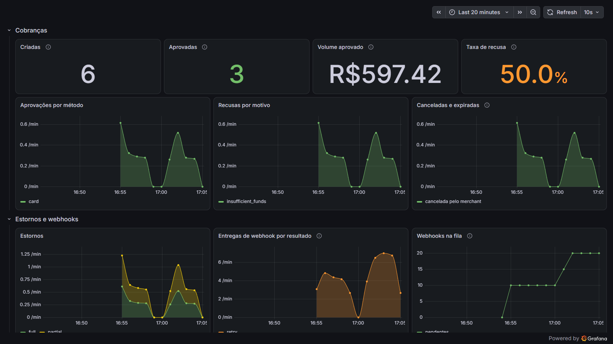

# StandardPay

[](https://github.com/holandale0/standard-pay/actions/workflows/ci.yml)

Simulador de plataforma de pagamentos — funciona como um PayPal ou um Stripe,
mas **nenhum dinheiro de verdade é movimentado**.

Serve para qualquer sistema que precise integrar pagamento antes de ter (ou
sem querer ter) uma conta numa plataforma real: protótipos, demonstrações para
clientes, ambientes de teste, aulas. O fluxo é o mesmo de uma plataforma real —
o sistema cria a cobrança, o pagador é redirecionado para uma página de
pagamento, e o sistema é avisado por webhook assinado — então trocar o
StandardPay por uma plataforma de verdade, depois, é trocar a integração, não
o desenho do sistema.

> Ambiente de simulação. Não há validação de cartão de verdade, não há
> liquidação, não há dinheiro. Não use para cobrar ninguém.

---

## 🎯 Motivação

Desenvolvo aplicações para fins comerciais, e essas aplicações tratam de
pagamentos. Num projeto assim, o pagamento costuma ser a última peça a
encaixar: integrar com uma plataforma de verdade exige conta, contrato,
cadastro de empresa — e tudo isso só faz sentido depois que a proposta
comercial é aprovada.

Esperar a aprovação para só então fazer a integração não seria muito legal. O
cliente quer ver a coisa toda funcionando antes de decidir, do pedido ao
"pagamento aprovado", mesmo que seja só uma simulação. Uma demonstração que
para justamente na hora de pagar deixa a pior parte para a imaginação.

**Por isso surgiu a ideia de criar o StandardPay: um checkout hub que simula
uma plataforma de pagamentos.**

A aplicação integra com ele exatamente como integraria com uma plataforma
real — cobrança, redirecionamento do pagador, webhook avisando o resultado,
estorno. Quando a proposta for aprovada e a plataforma de verdade for
escolhida, troca-se a integração, não o desenho do sistema.

---

## O que tem

- **Contas de lojista** com chave de API (`sk_test_…`) e segredo de webhook (`whsec_…`)
- **Cobranças** em centavos, com `metadata` livre e chave de idempotência
- **Página de pagamento hospedada**, em português, com cartão de crédito e PIX simulados
- **Cartões de teste** de resultado previsível — a mesma demonstração dá sempre o mesmo resultado
- **Webhooks assinados** (HMAC-SHA256, no formato do Stripe) com reenvio automático
- **Estornos** totais e parciais — e, com cartões de teste, estornos que levam dias ou que falham
- **Split**: a cobrança dividida entre recebedores, com saldo pendente e disponível e extrato por conta
- **Expiração** de cobranças não pagas
- Documentação interativa em `/q/swagger-ui`
- **Observabilidade**: logs correlacionados por requisição, métricas de negócio e traces que seguem até o webhook do lojista — com um Grafana pronto ([detalhes abaixo](#-observabilidade))

---

## 🛠️ Stack

| Categoria | Tecnologia | Versão |
|-----------|-----------|--------|
| Linguagem | Java | 21 |
| Framework | Quarkus | 3.40.1 |
| Build | Maven (wrapper incluído) | 3.9.16 |
| API REST | Quarkus REST + Jackson | 3.40.1 / 2.21 |
| Página de checkout | Qute (templates server-side) | 3.40.1 |
| Persistência | Hibernate ORM + Panache | 7.4 |
| Validação | Hibernate Validator | 9.1 |
| Transações | Narayana JTA | 7.3 |
| Banco de dados | PostgreSQL | 18 |
| Driver JDBC | PostgreSQL JDBC | 42.7 |
| Migrations | Flyway | 12.0 |
| Agendamento | Quarkus Scheduler | 3.40.1 |
| Documentação da API | SmallRye OpenAPI + Swagger UI | 4.3 |
| Health check | SmallRye Health | 4.3 |
| Traces e logs | OpenTelemetry (OTLP sobre HTTP) | 1.62 |
| Métricas | Micrometer — registros Prometheus e OTLP | 1.17 |
| Logs em JSON (produção) | Quarkus Logging JSON | 3.40.1 |
| Grafana local | `grafana/otel-lgtm` (Grafana, Prometheus, Tempo, Loki) | 0.36.0 |
| Testes | JUnit Jupiter + REST Assured | 6.1 / 6.0 |
| Banco nos testes | Quarkus Dev Services (Testcontainers) | `postgres:18-alpine` |
| Testes de arquitetura | ArchUnit | 1.5.1 |
| Testes de API | Postman (collection v2.1) + Newman | — / 6.2 |
| Diagramas | [archify](https://github.com/tt-a1i/archify) | 3.1 |
| Extração dos SVG | Python | 3 (testado no 3.14) |
| Imagem Docker | Build multi-stage; base `ubi9/openjdk-21-runtime` | 1.24 |
| Contêineres | Docker Compose | PostgreSQL 18 · otel-lgtm 0.36.0 |
| CI e publicação da imagem | GitHub Actions + GitHub Container Registry | — |

As versões das bibliotecas vêm do BOM do Quarkus — o `pom.xml` fixa só o
Quarkus e o ArchUnit (o `micrometer-registry-otlp` também vem do BOM). Para conferir as versões resolvidas:
`./mvnw dependency:list`.

O PostgreSQL é o mesmo nos testes e no `docker-compose.yml`: a imagem do Dev
Services está fixada em `application.properties`, para que uma atualização do
Quarkus não troque a versão do banco dos testes sem ninguém perceber.

---

## Rodando

### Só com Docker

Não precisa de Java nem de Maven. A imagem fica em
`ghcr.io/holandale0/standard-pay`, para amd64 e arm64:

```bash
docker network create standardpay
docker run -d --name standardpay-db --network standardpay \
  -e POSTGRES_DB=standardpay -e POSTGRES_USER=standardpay -e POSTGRES_PASSWORD=standardpay \
  postgres:18-alpine
docker run -d --name standardpay --network standardpay --restart unless-stopped \
  -p 127.0.0.1:8080:8080 \
  -e STANDARDPAY_DB_URL=jdbc:postgresql://standardpay-db:5432/standardpay \
  -e STANDARDPAY_DB_USER=standardpay -e STANDARDPAY_DB_PASSWORD=standardpay \
  ghcr.io/holandale0/standard-pay:latest
```

O `--restart` não é enfeite: o Postgres leva alguns segundos para aceitar
conexões, e o StandardPay que sobe antes dele encerra na hora. O Docker o sobe
de novo até o banco responder.

Ou, com este repositório clonado, o mesmo em um comando:

```bash
docker compose --profile app up -d                         # http://localhost:8080
STANDARDPAY_PORT=8095 docker compose --profile app up -d   # com a 8080 ocupada
```

A imagem roda no perfil de produção: o banco é obrigatório, e os logs saem em
JSON. A migration roda sozinha na subida. Se o pagador abrir a página de outra
máquina, informe o endereço dela em `STANDARDPAY_PUBLIC_URL`
([Configuração](#configuração)).

| Tag | Quando muda |
|---|---|
| `latest` | A cada push na `main`, depois de os testes passarem |
| `1.2.3`, `1.2`, `1` | A cada tag `v1.2.3` |
| `sha-abc1234` | Fixa num commit |

Para gerar a imagem localmente: `docker build -t standard-pay .`

### Com Java, para desenvolver

Precisa de Java 21 e Docker.

```bash
./mvnw quarkus:dev
```

O Quarkus sobe um Postgres descartável sozinho (Dev Services). A API fica em
http://localhost:8080 e a documentação interativa em
[http://localhost:8080/q/swagger-ui](http://localhost:8080/q/swagger-ui) — note
o `/q/`, que não existe no Spring ([detalhes abaixo](#explorando-a-api)).

> **"Port 8080 seems to be in use by another process"?** Outro programa já ocupa
> a 8080 — no Windows, é comum ser um serviço instalado (backup, antivírus,
> agentes de sistema). Rode em outra porta:
>
> ```bash
> PORT=8095 ./mvnw quarkus:dev                 # bash
> $env:PORT=8095; ./mvnw quarkus:dev           # PowerShell
> ```
>
> O `checkoutUrl` das cobranças acompanha a porta sozinho. Para descobrir quem
> está na 8080: `netstat -ano | findstr :8080` no Windows, `lsof -i :8080` no
> Linux e no macOS.

Para os dados persistirem entre execuções, use o Postgres do `docker-compose.yml`:

```bash
docker compose up -d
STANDARDPAY_DB_URL=jdbc:postgresql://localhost:5434/standardpay \
STANDARDPAY_DB_USER=standardpay STANDARDPAY_DB_PASSWORD=standardpay \
./mvnw package && java -jar target/quarkus-app/quarkus-run.jar
```

Testes (sobem um Postgres de verdade, também pelo Docker):

```bash
./mvnw test
```

## Explorando a API

Com a aplicação rodando:

- **Swagger UI:** [http://localhost:8080/q/swagger-ui](http://localhost:8080/q/swagger-ui)
- **Especificação OpenAPI:** [http://localhost:8080/q/openapi](http://localhost:8080/q/openapi)
  (YAML; acrescente `?format=json` para JSON)

Crie um lojista em `POST /v1/merchants`, copie a `apiKey` da resposta e cole em
**Authorize** — a partir daí dá para chamar todos os endpoints pela página.

> **Vindo do Spring?** No Quarkus, as rotas de infraestrutura ficam todas sob
> `/q/`. Os endereços que você conhece do springdoc e do Actuator não existem aqui:
>
> | | Spring Boot (springdoc / Actuator) | Quarkus |
> |---|---|---|
> | Swagger UI | `/swagger-ui.html` ou `/swagger-ui/index.html` | `/q/swagger-ui` |
> | Especificação OpenAPI | `/v3/api-docs` | `/q/openapi` |
> | Health check | `/actuator/health` | `/q/health` |
> | Dev UI (só em modo dev) | — | `/q/dev-ui` |

**Collection do Postman** em [`postman/`](postman): a jornada completa de uma
integração — criar lojista, cobrar, o pagador recusado e depois aprovado,
estornar em duas partes, ver um estorno ficar pendente, cancelar, conferir os
webhooks, dividir uma cobrança com uma recebedora — com 83 asserções.
As requisições são encadeadas: cada uma guarda nas variáveis da collection o
que a seguinte precisa, então basta rodar a pasta inteira, em ordem.

No Postman: importe os dois arquivos, escolha o ambiente *StandardPay local* e
use o Runner. Pela linha de comando:

```bash
npx newman run postman/StandardPay.postman_collection.json \
  -e postman/StandardPay.postman_environment.json
```

Para outro endereço, `--env-var baseUrl=https://...`.

## Integrando em 4 passos

### 1. Crie uma conta de lojista

```bash
curl -X POST http://localhost:8080/v1/merchants \
  -H 'Content-Type: application/json' \
  -d '{"name": "Minha Loja", "webhookUrl": "https://minhaloja.example/webhooks/standardpay"}'
```

A resposta traz `apiKey` e `webhookSecret`. **A chave só aparece nesta
resposta** — guarde-a. Todas as outras chamadas usam
`Authorization: Bearer sk_test_…`.

### 2. Crie a cobrança e redirecione o pagador

```bash
curl -X POST http://localhost:8080/v1/payments \
  -H 'Authorization: Bearer sk_test_...' \
  -H 'Content-Type: application/json' \
  -H 'Idempotency-Key: pedido-1234' \
  -d '{
    "amount": 19500,
    "description": "Pedido 1234",
    "metadata": {"orderId": "1234"},
    "returnUrl": "https://minhaloja.example/pedido/1234/obrigado",
    "cancelUrl": "https://minhaloja.example/carrinho"
  }'
```

Valores **em centavos**: `19500` é R$ 195,00. A resposta traz o `checkoutUrl`;
redirecione o pagador para lá. Se a requisição for repetida com a mesma
`Idempotency-Key`, volta a mesma cobrança — o duplo clique não cobra duas vezes.

### 3. O pagador paga

Na página, por cartão ou PIX. Depois, ele volta para o `returnUrl` com
`?payment_id=…&status=succeeded` — ou para o `cancelUrl`, se desistir.

> **Os parâmetros da volta não provam pagamento** — qualquer um digita uma URL.
> A prova é o webhook assinado, ou a consulta a `GET /v1/payments/{id}`.

### 4. Receba o webhook

```http
POST https://minhaloja.example/webhooks/standardpay
StandardPay-Signature: t=1760000000,v1=5257a869e7...

{
  "id": "evt_...",
  "type": "payment.succeeded",
  "createdAt": "2026-10-14T02:30:00Z",
  "data": { "id": "pay_...", "amount": 19500, "status": "succeeded", "metadata": {"orderId": "1234"}, ... }
}
```

Confira a assinatura antes de confiar no conteúdo (exemplo em Node):

```js
const [t, v1] = req.headers['standardpay-signature'].split(',').map(p => p.split('=')[1]);
const esperado = crypto.createHmac('sha256', process.env.STANDARDPAY_WEBHOOK_SECRET)
  .update(`${t}.${corpoCru}`)          // o corpo exatamente como chegou, antes de JSON.parse
  .digest('hex');
const valido = crypto.timingSafeEqual(Buffer.from(esperado), Buffer.from(v1))
  && Math.abs(Date.now() / 1000 - Number(t)) < 300;   // recuse assinaturas velhas
```

Responda com qualquer 2xx. Sem resposta, ou com erro, o StandardPay tenta de
novo: 1 min, 5 min, 30 min, 2 h, 6 h, 12 h, 24 h — 8 tentativas no total. Um
mesmo evento pode chegar mais de uma vez; use o `id` (`evt_…`) para ignorar
repetições.

| Evento | Quando |
|---|---|
| `payment.succeeded` | O pagador pagou |
| `payment.failed` | Uma tentativa de cartão foi recusada (a cobrança continua aberta) |
| `payment.canceled` | O lojista ou o pagador cancelou |
| `payment.expired` | Ninguém pagou dentro do prazo (30 min por padrão) |
| `refund.succeeded` | Um estorno foi concluído |
| `refund.pending` | Um estorno foi pedido e ainda não concluiu ([detalhes](#estornos-que-levam-tempo-e-que-falham)) |
| `refund.failed` | Um estorno pendente falhou; o valor pode ser estornado de novo |

## Cartões de teste

| Número | Resultado |
|---|---|
| `4242 4242 4242 4242` | Aprovado |
| `5555 5555 5555 4444` | Aprovado |
| `4000 0000 0000 0002` | Recusado (`card_declined`) |
| `4000 0000 0000 9995` | Saldo insuficiente (`insufficient_funds`) |
| `4000 0000 0000 0069` | Cartão vencido (`expired_card`) |
| `4000 0000 0000 0127` | CVV incorreto (`incorrect_cvc`) |
| `4000 0000 0000 7726` | Aprovado; o estorno fica pendente e conclui depois de 3 dias |
| `4000 0000 0000 5126` | Aprovado; o estorno fica pendente e falha (`expired_or_canceled_card`) |

Qualquer outro número com dígito verificador válido é aprovado. Validade e CVV
não são conferidos. O PIX tem um botão "Simular pagamento do PIX", que faz o
papel do banco avisando que o dinheiro caiu.

Um cartão recusado não encerra a cobrança: ela continua `pending` e o pagador
pode tentar outro cartão.

### Estornos que levam tempo, e que falham

Numa plataforma real, o estorno no cartão leva dias e pode falhar — o cartão foi
cancelado, por exemplo. Os dois últimos cartões da tabela simulam isso; com os
outros cartões e com PIX, o estorno conclui na hora.

```
 (cartão comum, PIX) ──────────────► succeeded
 (7726, 5126)        ──► pending ──┬► succeeded   7726, depois de 3 dias
                                   └► failed      5126, depois de 1 minuto
```

- O valor pendente **já conta** em `amountRefunded`: não dá para pedir de novo o
  que está a caminho.
- Se o estorno falha, o valor sai de `amountRefunded` e pode ser estornado de novo.
- O lojista é avisado em cada passo: `refund.pending`, `refund.succeeded`,
  `refund.failed`.
- Os prazos são configuráveis ([Configuração](#configuração)). Para uma
  demonstração: `STANDARDPAY_REFUNDS_DELAYED_BY=PT2M`.

## Split: dividindo a cobrança

Uma cobrança pode ser dividida entre **recebedores** — a guia de um passeio, o
vendedor de um marketplace. Cada um tem saldo e extrato próprios; o que sobra
das partes fica com o lojista, que também tem os seus.

```bash
# 1. Cadastre o recebedor, uma vez
curl -X POST http://localhost:8080/v1/recipients \
  -H "Authorization: Bearer sk_test_..." -H "Content-Type: application/json" \
  -d '{ "name": "Guia Ana", "metadata": { "guideId": "7" } }'
# → { "id": "rcp_...", ... }

# 2. Na cobrança, diga quanto é de cada um (em centavos)
curl -X POST http://localhost:8080/v1/payments \
  -H "Authorization: Bearer sk_test_..." -H "Content-Type: application/json" \
  -d '{ "amount": 10000, "splits": [{ "recipientId": "rcp_...", "amount": 7000 }] }'
```

Paga a cobrança, R$ 70,00 entram no saldo da guia e R$ 30,00 no do lojista —
**pendentes** até o prazo de liberação (D+1 por padrão), e **disponíveis**
depois:

```json
GET /v1/recipients/rcp_.../balance
{ "account": "rcp_...", "balances": [{ "currency": "BRL", "available": 0, "pending": 7000 }] }
```

- **Estorno sai de cada conta na proporção do que ela recebeu.** Estornar metade
  da cobrança acima tira R$ 35,00 da guia e R$ 15,00 do lojista. O estorno sai
  do saldo disponível na hora, e por isso o disponível pode ficar negativo
  enquanto o crédito ainda está pendente — como nas plataformas reais.
- **Nenhum centavo se perde no arredondamento.** A proporção é calculada sobre o
  total já estornado, e não estorno a estorno: estornada a cobrança inteira, em
  quantas partes for, cada conta devolveu exatamente o que recebeu.
- **Estorno que falha devolve** a parte de cada conta.
- **O extrato nunca é reescrito.** Cada crédito, débito e devolução é uma linha
  (`payment`, `refund`, `refund_failure`); o saldo é a soma delas.
- As partes somam no máximo o valor da cobrança, são de recebedores do próprio
  lojista, até 10 por cobrança. Senão: `400 invalid_split`.

## API

| Método | Caminho | Para quê |
|---|---|---|
| `POST` | `/v1/merchants` | Criar conta (sem autenticação) |
| `GET` / `PATCH` | `/v1/merchants/me` | Ver a conta / trocar o `webhookUrl` |
| `POST` | `/v1/merchants/me/webhook-secret` | Trocar o segredo dos webhooks |
| `POST` | `/v1/payments` | Criar cobrança |
| `GET` | `/v1/payments` | Listar (`?status=succeeded&limit=50`) |
| `GET` | `/v1/payments/{id}` | Consultar |
| `POST` | `/v1/payments/{id}/cancel` | Cancelar enquanto pendente |
| `POST` | `/v1/payments/{id}/refunds` | Estornar (sem `amount`, estorna tudo o que resta) |
| `GET` | `/v1/payments/{id}/refunds` | Estornos da cobrança |
| `POST` / `GET` | `/v1/recipients` | Cadastrar / listar recebedores |
| `GET` | `/v1/recipients/{id}` | Consultar um recebedor |
| `GET` | `/v1/recipients/{id}/balance` | Saldo do recebedor, disponível e pendente |
| `GET` | `/v1/recipients/{id}/transactions` | Extrato do recebedor |
| `GET` | `/v1/balance` | Saldo do próprio lojista |
| `GET` | `/v1/balance/transactions` | Extrato do próprio lojista |
| `GET` | `/v1/webhook-deliveries` | O que foi enviado, e o que aconteceu em cada envio |
| `POST` | `/v1/webhook-deliveries/{id}/retry` | Enviar de novo |

Todo erro sai no mesmo formato, com um `code` estável para o programa decidir
o que fazer e uma `message` para quem está depurando:

```json
{ "error": { "code": "amount_too_large", "message": "Refund amount 20000 exceeds the refundable 19500 (amounts are in cents).", "requestId": "req_4kVt0Wb4cRMyx2RkVk7aB9qE" } }
```

O `requestId` é o mesmo do cabeçalho `X-Request-Id` da resposta, e aparece em
toda linha de log daquela requisição — é o que o lojista manda para o suporte.

## Configuração

| Variável | Padrão | |
|---|---|---|
| `STANDARDPAY_PUBLIC_URL` | `http://localhost:8080` | Endereço público; entra no `checkoutUrl`. Precisa ser alcançável pelo pagador. |
| `STANDARDPAY_DB_URL`, `_USER`, `_PASSWORD` | — | Postgres, em produção |
| `STANDARDPAY_CHECKOUT_EXPIRES_IN` | `PT30M` | Prazo da cobrança (ISO-8601) |
| `STANDARDPAY_WEBHOOKS_POLL_INTERVAL` | `5s` | De quanto em quanto tempo os webhooks pendentes saem |
| `STANDARDPAY_WEBHOOKS_MAX_ATTEMPTS` | `8` | Tentativas antes de desistir |
| `STANDARDPAY_WEBHOOKS_TIMEOUT` | `PT10S` | Quanto esperar a resposta do lojista |
| `STANDARDPAY_REFUNDS_DELAYED_BY` | `P3D` | Quanto o estorno do cartão `…7726` leva para concluir |
| `STANDARDPAY_REFUNDS_FAILS_AFTER` | `PT1M` | Quanto o estorno do cartão `…5126` leva para falhar |
| `STANDARDPAY_REFUNDS_POLL_INTERVAL` | `30s` | De quanto em quanto tempo os estornos pendentes são resolvidos |
| `STANDARDPAY_BALANCES_AVAILABLE_AFTER` | `P1D` | Quanto o valor de uma cobrança paga fica pendente no saldo antes de ficar disponível |
| `PORT` | `8080` | Porta HTTP |
| `QUARKUS_OTEL_SDK_DISABLED` | `true` | `false` liga a telemetria ([Observabilidade](#-observabilidade)) |
| `STANDARDPAY_OTEL_ENDPOINT` | `http://localhost:4318` | Coletor OpenTelemetry (OTLP sobre HTTP) |

---

## 🔭 Observabilidade

Três sinais, ligados entre si: cada linha de log diz a que requisição e a que
trace pertence; cada trace mostra as consultas ao banco que a requisição fez; e
o trace continua no lojista, pelo webhook.



### Subindo o Grafana

```bash
docker compose --profile observabilidade up -d          # Grafana em http://localhost:3001 (admin / admin)
QUARKUS_OTEL_SDK_DISABLED=false ./mvnw quarkus:dev      # bash
$env:QUARKUS_OTEL_SDK_DISABLED="false"; ./mvnw quarkus:dev   # PowerShell
```

O contêiner `grafana/otel-lgtm` reúne Grafana, Prometheus (métricas), Tempo
(traces) e Loki (logs), e recebe os três por OTLP na porta 4318. O painel
**StandardPay** já vem carregado, na pasta de mesmo nome.

> **Na primeira vez, o Grafana leva alguns minutos para responder** — ele
> prepara o próprio banco. Os dados ficam no volume `standardpay-observabilidade`,
> e as subidas seguintes são rápidas.

A telemetria vem desligada: sem coletor no ar, o exportador reclamaria no log a
cada poucos segundos. O Quarkus também subiria um Grafana próprio a cada
`quarkus:dev` — isso está desligado (`quarkus.observability.enabled=false`); o
Grafana é escolha explícita, pelo perfil do compose.

### Logs

```
14:02:11.418 INFO  [o.l.s.p.c.PaymentTelemetry] [req=req_8f2K… trace=4ffbf63e…] Payment pay_jWZL… succeeded via card: 19500 BRL (cents)
14:02:16.530 WARN  [o.l.s.w.c.WebhookTelemetry] [req= trace=c935daeb…] Webhook evt_PUwt… (payment.succeeded) attempt 2 failed: ConnectException; next attempt at …
```

- Toda requisição ganha um `X-Request-Id`, devolvido na resposta. Se o cliente
  mandar um, ele é mantido — desde que seja curto e só tenha letras, números e
  `._:-`; senão, é trocado, para ninguém forjar linhas no log.
- Depois da autenticação, o `merchantId` também entra no contexto do log.
- Eventos de negócio — cobrança criada, paga, recusada, cancelada, expirada;
  estorno; lojista cadastrado; troca de segredo — saem em `INFO`. Webhook que vai
  ser reenviado sai em `WARN`; o que esgotou as tentativas, em `ERROR`.
- Chaves de API e segredos nunca vão para o log — nem a chave rejeitada.
- Em produção (`%prod`), o console sai em JSON, uma linha por evento.

### Métricas

| Métrica (Prometheus) | Tipo | Rótulos |
|---|---|---|
| `standardpay_payments_created_total` | contador | `currency` |
| `standardpay_payments_succeeded_total` | contador | `method` (`card`, `pix`), `currency` |
| `standardpay_payments_succeeded_amount_cents_total` | contador (centavos) | `currency` |
| `standardpay_payments_declined_total` | contador | `reason` (`insufficient_funds`, `card_declined`…) |
| `standardpay_payments_canceled_total` | contador | `by` (`merchant`, `payer`) |
| `standardpay_payments_expired_total` | contador | — |
| `standardpay_refunds_total` | contador (só os concluídos) | `type` (`full`, `partial`) |
| `standardpay_refunds_amount_cents_total` | contador (centavos) | `currency` |
| `standardpay_refunds_pending_total` | contador | — |
| `standardpay_refunds_failed_total` | contador | `reason` |
| `standardpay_webhooks_delivery_milliseconds` | histograma | `event`, `outcome` (`delivered`, `retry`, `gave_up`) |
| `standardpay_webhooks_pending` | medidor | — |
| `http_server_requests_milliseconds` | histograma | `method`, `uri`, `status` |

Também ficam em [`/q/metrics`](http://localhost:8080/q/metrics), no formato do
Prometheus, mesmo com a telemetria desligada (lá, com os nomes em segundos).

- As métricas de negócio são registradas **depois do commit**: uma transação
  desfeita não conta como cobrança criada.
- Nenhuma tem o lojista como rótulo — cada lojista viraria uma série nova, sem
  limite. Para olhar um lojista, filtre os logs pelo `merchantId`.
- Os histogramas têm faixas fixas, de 5 ms a 10 s, para o p95 sair do Prometheus.

### Traces

- Cada requisição vira um trace, com uma etapa por consulta ao banco.
- As rodadas do agendador (envio de webhooks, expiração) também.
- O envio de um webhook é uma etapa própria (`POST webhook payment.succeeded`), e
  leva o cabeçalho [`traceparent`](https://www.w3.org/TR/trace-context/) ao
  lojista: se o sistema dele também usar OpenTelemetry, o trace continua lá.

## 🏗️ Arquitetura


Um serviço só — Quarkus 3, Java 21, PostgreSQL com migrations Flyway —
organizado em **BCE (Boundary-Control-Entity)** por componente de negócio. Em
cada componente, `boundary` é a borda HTTP, `control` são as regras e `entity`
é o que vai para o banco.

As regras do BCE não são só convenção: o `ArchitectureTest`, com
[ArchUnit](https://www.archunit.org/), quebra o build se uma delas for violada —
`control` dependendo de `boundary`, ciclo entre componentes, entidade JPA fora
de `entity`, código HTTP fora de `boundary`, transação aberta na borda.

Decisões que valem saber:

- **Webhooks pela tabela, não por fila de mensagens** (padrão *outbox*). O
  evento é gravado na mesma transação que muda o pagamento: não existe pagamento
  aprovado cujo aviso se perdeu, nem aviso de pagamento que não foi gravado. Um
  agendador envia os pendentes.
- **Linha travada antes de mudar estado.** Dois cliques simultâneos em "Pagar",
  ou dois estornos ao mesmo tempo, não passam os dois.
- **Chave de API guardada como SHA-256.** Quem lê o banco não consegue se passar
  pelo lojista.
- **Valores em centavos**, como nas plataformas reais.
- **Saldo como soma do extrato.** Não há coluna de saldo para manter em dia: o
  saldo é a soma dos lançamentos, e cada um diz desde quando está disponível. O
  pendente vira disponível sem varredura nenhuma, e saldo e extrato nunca
  divergem.

---

## 📐 Diagramas

### Da cobrança ao webhook


Repare na ordem do fim: o pagador costuma **voltar à loja antes** de o webhook
chegar — o despachante passa a cada 5 segundos. Por isso a tela de volta não
pode depender do webhook, e a URL de volta não serve de prova de pagamento:
quem confirma é o webhook, ou a consulta à API.

### Ciclo de vida de uma cobrança


Duas coisas **não** mudam o estado. Cartão recusado mantém a cobrança
pendente, para o pagador tentar outro cartão. E estorno mantém o pagamento
aprovado — ele foi pago; o que muda é `amountRefunded`.

### Ciclo de vida de uma entrega de webhook


Uma entrega que desistiu não está perdida: `POST /v1/webhook-deliveries/{id}/retry`
a recoloca na fila.

> Os diagramas acima são retratos estáticos. As versões **interativas** — com
> visões guiadas, links para o código-fonte de cada componente e tema
> claro/escuro — estão em **[diagrams/](./diagrams/)**, junto de como foram
> geradas.

---

## 📂 Estrutura do projeto

```
standard-pay/
├── src/main/java/org/leonardo/standardpay/
│   ├── merchants/                 ← contas de lojista e autenticação por chave de API
│   │   ├── boundary/              ← MerchantsResource · ApiKeyFilter
│   │   ├── control/               ← MerchantRegistry · Credentials (chave e segredo)
│   │   └── entity/                ← Merchant
│   ├── payments/                  ← cobranças
│   │   ├── boundary/              ← PaymentsResource
│   │   ├── control/               ← PaymentProcessor · TestCards
│   │   └── entity/                ← Payment · PaymentStatus · PaymentView
│   ├── checkout/
│   │   └── boundary/              ← CheckoutResource: a página do pagador
│   ├── refunds/                   ← estornos: boundary · control · entity
│   ├── balances/                  ← split: recebedores, extrato (Ledger) e saldos
│   ├── webhooks/                  ← eventos para o lojista
│   │   ├── boundary/              ← WebhookDeliveriesResource
│   │   ├── control/               ← WebhookPublisher · WebhookDispatcher · Signatures
│   │   └── entity/                ← WebhookDelivery (a fila outbox)
│   └── platform/                  ← ids, formato de erro, X-Request-Id, OpenAPI, métricas — não conhece componente nenhum
├── src/main/resources/
│   ├── application.properties
│   ├── db/migration/              ← migrations Flyway
│   └── templates/                 ← página de checkout (Qute)
├── src/test/java/org/leonardo/standardpay/
│   ├── ArchitectureTest.java      ← as regras do BCE, com ArchUnit
│   ├── ObservabilityTest.java     ← X-Request-Id, métricas e traceparent
│   ├── merchants/ · payments/ · checkout/ · refunds/ · webhooks/ · balances/
│   └── support/                   ← Api (atalhos) · WebhookSink (lojista de mentira)
├── diagrams/                      ← diagramas archify: JSON-fonte, HTML interativo e SVG
├── observabilidade/               ← painel do Grafana, carregado pelo docker-compose
├── postman/                       ← collection com a jornada completa e 83 asserções
├── scripts/                       ← extração dos SVG dos diagramas
├── .github/workflows/ci.yml       ← testes em todo push; publica a imagem na main e nas tags
├── Dockerfile                     ← compila e empacota dentro do Docker, para amd64 e arm64
└── docker-compose.yml             ← PostgreSQL; nos perfis app e observabilidade, o StandardPay e o Grafana
```

---

## Testes

Cada teste é dividido em blocos marcados por comentário:

```java
// Arrange   prepara o cenário
// Act       a única ação sob teste
// Assert    o resultado direto da ação
// Verify    os efeitos colaterais: o que ficou gravado, o webhook enfileirado
```

Um teste tem um `// Act` só. Quando aparece a vontade de um segundo, são dois
testes: se ele falhar, o nome já diz qual das duas coisas quebrou.

## Próximos passos

- Painel web do lojista (hoje, tudo é pela API)

## Licença

[MIT](LICENSE)
